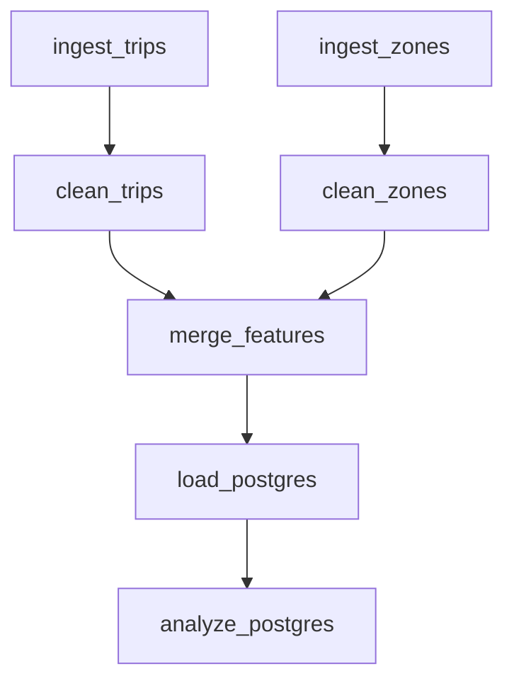
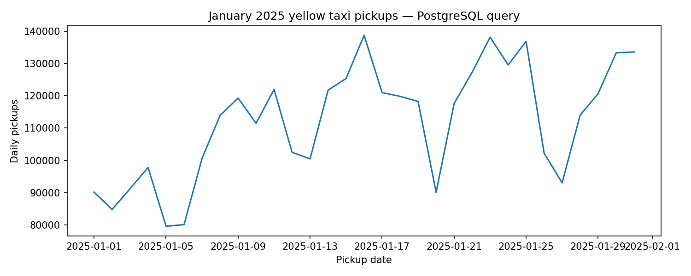
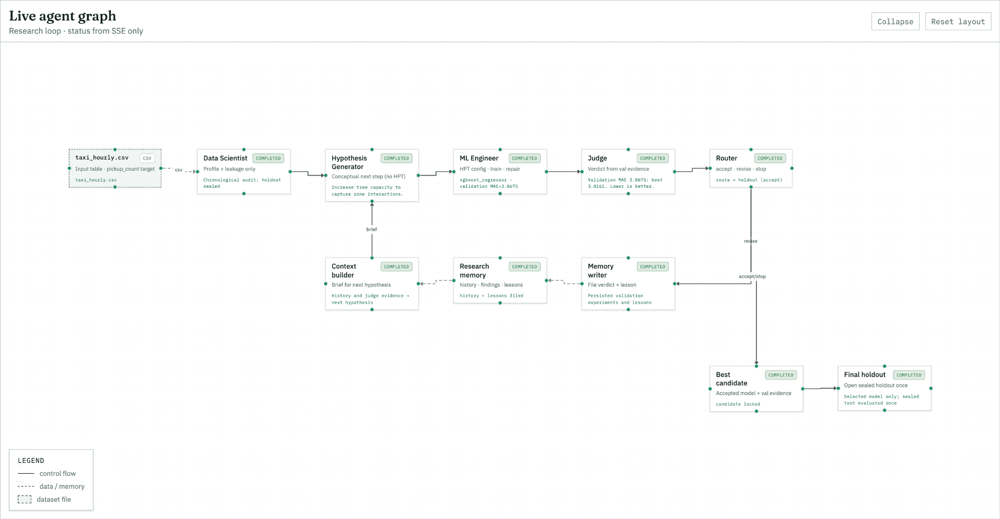
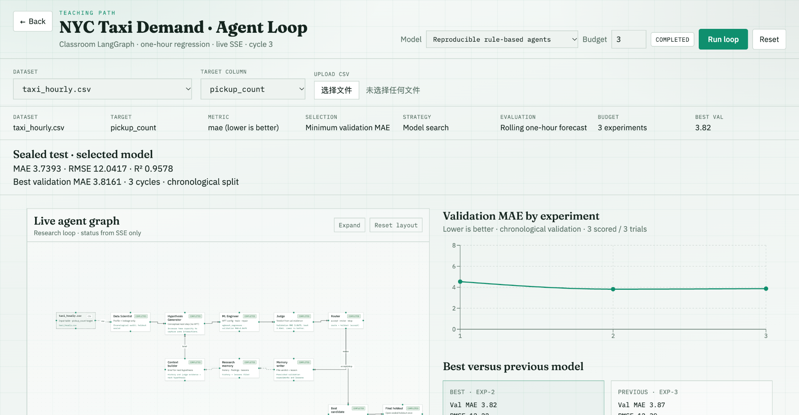

# NYC Taxi Demand Forecasting — IDS 706

**Author: Rongsheng (Royce) Zhang**

An end-to-end Airflow pipeline cleans and joins two official NYC taxi datasets,
loads hourly demand into PostgreSQL, and produces database-backed analysis.
The instructor's classroom LangGraph loop then compares seasonal naive and
XGBoost regression models, while the existing live Agent Graph displays actual
SSE events and evaluation metrics.

**Parts 1–2 have been executed successfully on local Docker Desktop.**
The recorded container test run passed **11/11 tests**, including PostgreSQL
integration. Four genuine UI screenshots and machine-readable execution records
are included. Optional Part 3 is not claimed.

## Run the project

Requires Docker Desktop with Compose v2, Python 3 for the verification script,
internet access, and ports 5433, 8000, 8088, and 5173 available. Run from this
repository's root:

```bash
docker compose -f infra/compose.taxi.yml up --build -d
python3 scripts/verify_local.py
```

The first build installs dependencies and downloads approximately 59 MB of trip
data. The script waits for Airflow, unpauses and triggers the DAG, checks actual
parallel execution, verifies repeat-load consistency, runs integration tests,
restores the full January dataset, and executes the agent workflow. It exits
with an error if a required verification fails.

| Interface | Address | Instructions |
|---|---|---|
| Airflow | http://localhost:8088 | Login `admin` / `admin`; open `nyc_taxi_demand` |
| Live Agent Graph | http://localhost:5173/solution-loop | Select `taxi_hourly.csv`, target `pickup_count`, budget 3; click **Run loop** |
| PostgreSQL | localhost:5433 | Database/user/password: `taxi` / `taxi` / `taxi` |

Credentials are local classroom defaults. No API key is required. Keep the
containers running while viewing the graph. To stop them and preserve data:

```bash
docker compose -f infra/compose.taxi.yml down
```

## Part 1 — Airflow pipeline

**Sources:** [January 2025 yellow taxi trips](https://d37ci6vzurychx.cloudfront.net/trip-data/yellow_tripdata_2025-01.parquet)
and the [NYC taxi zone lookup](https://d37ci6vzurychx.cloudfront.net/misc/taxi_zone_lookup.csv).
The join is **`PULocationID = LocationID`**, validated as many-to-one.



- Keep valid pickup timestamps in January 2025. Read only pickup time and zone
  ID from the trip file; validate unique zone lookup keys and fill missing zone
  descriptions with `Unknown`. Distinct trips sharing time/zone are not deduplicated.
- Join and count pickups per zone/hour. Reindex every lookup zone across all
  744 January hours; absent observations become zero demand.
- Add zone ID, hour, weekday, calendar day, weekend, and zone-specific demand
  lags of **1, 24, and 168 hours**. Missing initial lag history stays NULL.
- Load PostgreSQL in one transaction with an advisory lock, a zone/hour primary
  key, and replacement of January rows. Repeated loads produce identical data.
- Query PostgreSQL, export sorted rows to `datasets/taxi/taxi_hourly.csv`, and
  create `artifacts/taxi/eda_postgres.png`. The recorded EDA is shown below.

The DAG runs daily at **06:00 UTC** (`0 6 * * *`) with `catchup=False` and one
active DAG run. The instructor's Airflow **2.10.4 LocalExecutor** allows four
active tasks. The ingestion and cleaning branches have independent dependencies;
recorded task intervals confirm overlap for both ingestion and cleaning pairs.
The schedule refreshes a fixed historical January snapshot, not live taxi data.

**Observed data:** 3,475,226 raw trips → **3,475,204 January pickups**, all matched
with the lookup; **197,160 zone-hour rows**, **265 zones**, and **100,146 zero-demand
hours**. The excluded 22 trips lie outside the retained valid January window.



## Part 2 — Modified classroom agents

The original seven-node LangGraph topology, gateway event stream, React Flow
Agent Graph, experiment timeline, and run history are reused:

**Data Scientist → Hypothesis → ML Engineer → Judge → Holdout Evaluation**, or
**Judge → Memory → Context → Hypothesis** for another trial.

| Agent / node | Regression adaptation |
|---|---|
| Data Scientist | Profiles chronological train/validation data and checks leakage risks |
| Hypothesis | Starts with weekly seasonality, then proposes boosted-tree capacity or regularization using prior validation evidence |
| ML Engineer | Runs a seasonal naive baseline and bounded XGBoost configurations |
| Judge | Retains the lowest validation MAE, including an earlier model if a later trial is worse |
| Memory / Context | Persists all validation trials and supplies lessons to the next cycle |
| Holdout Evaluation | Locks the selected configuration, refits on train+validation, and evaluates the test set once per run |

The agents use **explicit rule-based decisions, with no LLM calls**. This keeps
the classroom graph reproducible without credentials. The third XGBoost trial
increases capacity when trial 2 beats the baseline, otherwise it regularizes.
The loop is capped at **three experiments**, including the baseline. These are
sequential role-specific LangGraph agents; no optional adaptive-system bonus is
claimed.

The live UI uses MAE with **lower-is-better** selection, shows MAE/RMSE/R²,
updates node statuses and notes from real SSE events, and retains experiment
history. Node-start events are emitted before node computation.

### Forecast protocol and results

At time **t**, predict pickups during **[t, t+1)**. Lag 1 contains the completed
**[t−1, t)** hour. Calendar features are known in advance. Current-hour demand,
fares, and drop-off data are excluded from model inputs.

| Partition | January 2025 target dates | Rows |
|---|---|---:|
| Train | 8–21 | 89,040 |
| Validation | 22–26 | 31,800 |
| Test | 27–31 | 31,800 |

January 1–7 supplies history. Every method uses identical complete-lag rows.
This is rolling one-hour forecasting: earlier observed validation/test demand
may enter later lag features. It is not a multi-day forecast without updates.
Model selection uses validation labels only; test outcomes do not enter memory.

| Experiment | Method | Validation MAE | RMSE | R² |
|---|---|---:|---:|---:|
| 1 | Seasonal naive: same hour last week | 4.5361 | 15.0427 | 0.9417 |
| **2 — selected** | XGBoost: 180 trees, depth 5, learning rate 0.08 | **3.8161** | **12.2241** | **0.9615** |
| 3 | XGBoost: 260 trees, depth 7, learning rate 0.05 | 3.8675 | 12.3897 | 0.9604 |

Selected-model **sealed-test MAE = 3.7393, RMSE = 12.0417, R² = 0.9578**.
Validation MAE improved **15.87%** over seasonal naive. Increasing capacity in
trial 3 did not improve validation MAE, so the Judge retained trial 2.
The recorded complete loop took **1.79 seconds**, excluding ETL and image builds.
This timing is hardware-specific. Pooled performance includes many zero-demand
hours and between-zone demand differences; one month does not establish
performance in other seasons.

## Verification and screenshots

`python3 scripts/verify_local.py` completed on Docker Desktop, with **11 tests
passed** including the database integration test. It checked successful DAG
execution, declared schedule, overlapping branch task intervals, database totals,
identical repeat-export hashes, PostgreSQL EDA, and the complete agent loop.
The included screenshot also shows a successful **scheduled** DAG run. Browser
screenshots show the completed live graph and the same evaluation metrics.

| Evidence | File |
|---|---|
| Successful scheduled DAG execution | [airflow_success.png](screenshots/airflow_success.png) |
| DAG graph and parallel branches | [airflow_graph.png](screenshots/airflow_graph.png) |
| Completed live Agent Graph | [agent_graph.png](screenshots/agent_graph.png) |
| Evaluation results | [evaluation_results.png](screenshots/evaluation_results.png) |
| Task intervals / successful repeat loads | [airflow_execution.json](evidence/airflow_execution.json) |
| Data quality, source and export hashes | [evidence/README.md](evidence/README.md) |
| Selected configuration and actual model results | [evaluation.json](evidence/evaluation.json) |




Run tests separately with:

```bash
# Default run: database integration is skipped.
docker compose -f infra/compose.taxi.yml exec gateway python -m pytest tests/taxi -q -ra
# Full real pipeline and database integration, followed by data restoration:
python3 scripts/verify_local.py
# Check the prepared upload contents without Docker:
python3 scripts/pre_upload_check.py
```

The integration test temporarily replaces January data in the disposable
assignment database. The verification script restores the full January dataset
after successful tests. If verification stops during integration testing, rerun
the DAG before training. Deprecation warnings concern inherited framework APIs;
they did not prevent execution.

## Repository guide and reproducibility

| Path | Purpose |
|---|---|
| `solution/airflow/dags/nyc_taxi_demand.py` | Scheduled DAG |
| `taxi/etl.py` | Cleaning, features, PostgreSQL writes, SQL analysis |
| `solution/langgraph/graph.py` | Existing graph wiring with regression dispatch and streaming |
| `solution/langgraph/taxi_regression.py` | Regression-specific agent bodies |
| `loop_runtime.py` | Shared metric and chronological-split helpers |
| `frontend/src/pages/SolutionLoopPage.tsx` | Regression loop UI |
| `frontend/src/components/LiveSimpleLoopGraph.tsx` | Existing live graph |
| `infra/compose.taxi.yml`, `infra/Dockerfile.*` | Container setup |
| `requirements-taxi.txt`, `frontend/package-lock.json` | Dependency versions |
| `tests/taxi/` | Leakage, routing, metrics, SSE and database checks |
| `evidence/`, `screenshots/` | Recorded submission evidence |

Runtime outputs go to ignored `artifacts/` and `datasets/taxi/`; checked-in evidence
is a snapshot of the successful local run. Raw downloads, generated models,
virtual environments, caches, and local run registries are excluded from Git.

**Instructor attribution:** based on
[Kedar-V/automl-research-lab, branch `refactor/lab-solution-layout`](https://github.com/Kedar-V/automl-research-lab/tree/refactor/lab-solution-layout),
snapshot `a294145ea9aa4225908ce701c06160c33213335d`.
Original instructions remain in [README.instructor.md](README.instructor.md).
The `lab/` and unrelated `advanced/` source are retained for instructor imports
and provenance; the assignment does not require their full service stack.
